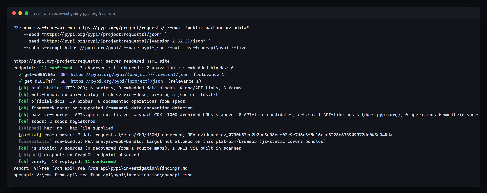
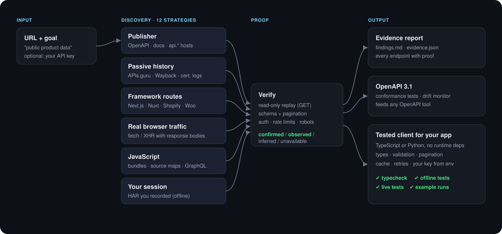
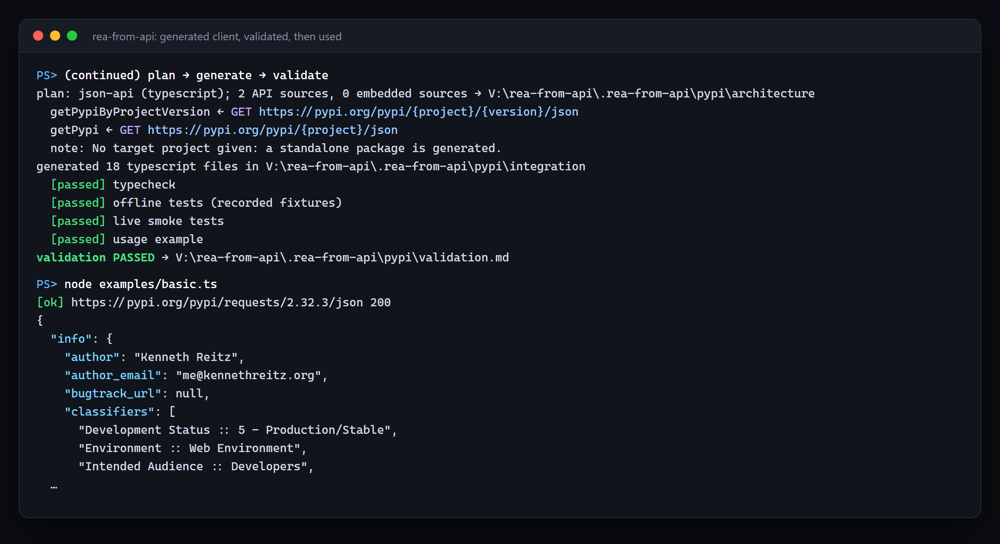

<div align="center">

**English** · [Português (Brasil)](docs/readme/README_pt-BR.md)

# rea-from-api

### Turn any website's data into a tested API client for your app.

**See data on a site you need. Find out exactly how it is served, with proof, and get typed, tested code.**

[](https://www.npmjs.com/package/rea-from-api)
[](https://github.com/vitorcgo/rea-from-api/actions/workflows/ci.yml)
[](#mcp-tools)
[](docs/evidence-model.md)
[](#quick-start)
[](LICENSE)

[What you can do](#what-you-can-do) · [Quick start](#quick-start) · [How it works](#how-it-works) · [What it discovers](#what-it-discovers) · [Showcase](#showcase) · [FAQ](#faq) · [Docs](#documentation)

<code>npx rea-from-api setup</code>

<br /><br />



</div>

---

Need the products, prices, packages, listings or stats a website shows? Ask your agent to investigate
it with rea-from-api. It finds where the data really comes from (an official API, a published OpenAPI
document, the requests a web app makes in the browser, a framework data route, or JSON embedded in the
HTML), proves each source with read-only requests, writes the API down as **OpenAPI 3.1**, and generates
a **tested TypeScript or Python client** you can drop into your project.

Every claim comes with evidence: which strategy found it, the request that confirmed it and a hash of
the bytes. Nothing is invented: a route seen only in JavaScript stays *inferred* until a real response
proves it. Browser capture and bundle analysis are powered by the [REA](https://github.com/morluto/rea)
engine.

## What you can do

| You want to… | rea-from-api gives you |
|---|---|
| **Show a store's catalog or prices in your app** | The products endpoint, its filters and pagination, and a typed client with `listProducts()` / `iterateProducts()` |
| **Find the official API you didn't know existed** | Specs the site publishes (`/.well-known/api-catalog`, OpenAPI, `llms.txt`), APIs.guru listings and `api.` / `developer.` hosts from certificate logs |
| **Use an API that needs a key** | Verification with **your own** key (`--auth-env`) and a client that reads it from the environment, never storing it |
| **Get data from a site with no API** | JSON-LD, `__NEXT_DATA__` or framework data routes turned into an extractor with the same tests |
| **Integrate a single-page app's data** | The fetch/XHR calls the page makes, with real response bodies, schemas and pagination |
| **Know when an integration will break** | `monitor` re-checks the API later and reports breaking changes; `diff` compares any two specs |
| **Use your favorite API tools** | `openapi.json` for Postman, Insomnia, mock servers, linters or any code generator |
| **Feed your own project directly** | `--target ../my-app` writes the client into your project (TypeScript or Python), with tests |

## Quick start

Works on Windows, macOS and Linux with Node.js 22.18+.

### Set up your agent

```bash
npx rea-from-api setup
```

Setup detects your agents, shows exactly what it will change, asks before applying, and backs up each
config. Restart your agents afterward.

| Agent | `--agent` | Config |
|---|---|---|
| Claude Code | `claude-code` | `~/.claude.json` + `~/.claude/skills/rea-from-api` |
| Claude Desktop | `claude-desktop` | `claude_desktop_config.json` |
| Codex | `codex` | `~/.codex/config.toml` |
| Cursor | `cursor` | `~/.cursor/mcp.json` |
| VS Code (Copilot) | `vscode` | user `mcp.json` |
| Windsurf | `windsurf` | `~/.codeium/windsurf/mcp_config.json` |
| Gemini CLI | `gemini` | `~/.gemini/settings.json` |
| Current project | `project` | `.mcp.json` + `.claude/skills/rea-from-api` |

`--agent <id>` (repeatable) or `--all` choose agents non-interactively, `--yes` skips the prompt,
`--dry-run` only prints the plan and `--uninstall` removes everything setup added. Any other MCP client
can run `npx -y rea-from-api mcp`.

### Ask your agent

```text
Investigate https://example.com, find out how it serves its public product data,
show me the evidence, and build a TypeScript integration for my project.
```

### Or use the terminal

```bash
npx rea-from-api run https://example.com --goal "public product data" --target ../my-app --live
```

`run` = `investigate` → `plan` → `generate` → `validate`. Each step also runs on its own; see
`npx rea-from-api help`. `npx rea-from-api doctor` shows which optional engines are available.

### APIs that need your key

Most official APIs require a key. Put **your own** key in an environment variable and pass its name.
It is sent only to the target's API and never written to reports, fixtures or generated code.

```bash
export MY_API_KEY=...            # PowerShell: $env:MY_API_KEY = "..."
npx rea-from-api run https://api.example.com/docs --goal "orders data" \
  --auth-env MY_API_KEY --auth-header X-Api-Key        # or: --auth-query api_key
```

## How it works

<p align="center">
  
</p>

Your agent calls the same operations through MCP that you can run from the terminal. Results are compact
summaries with paths to the full artifacts: `findings.md`, `endpoints.json`, `evidence.json`,
`openapi.json`, `plan.md` and `validation.md`.

## What it discovers

| Source | What you get | Needs |
|---|---|---|
| Publisher declarations | [RFC 9727](https://www.rfc-editor.org/rfc/rfc9727) `api-catalog`, `Link: rel=service-desc`, `ai-plugin.json`, `llms.txt` → specs and docs | nothing |
| OpenAPI / Swagger / WordPress REST | Documented operations (JSON or YAML) | nothing |
| API directories | Official specs listed on [APIs.guru](https://apis.guru) for the domain | internet |
| Web history | API/JSON URLs archived by the Wayback Machine, re-verified today | internet |
| API hosts | `api.*`, `developer.*` hosts from Certificate Transparency, checked for specs | internet |
| Framework data routes | Next.js `/_next/data`, Gatsby `page-data`, Nuxt `_payload`, SvelteKit `__data`, WooCommerce Store API, Shopify storefront JSON, Drupal JSON:API | detected framework |
| Browser traffic | fetch/XHR requests with response bodies, captured in a real browser | Chrome, Edge or Chromium |
| JavaScript | URLs, methods and headers from bundles; **source maps** recover the original API modules | optional [jsluice](https://github.com/BishopFox/jsluice) |
| GraphQL | The schema through the standard introspection query | public introspection |
| Your own session | A HAR you recorded, read offline with credentials redacted | nothing |
| HTML | JSON-LD, `__NEXT_DATA__`, inline state, GET forms, technology hints | nothing |

| Output | Details |
|---|---|
| Evidence | Every endpoint: confirmed / observed / inferred / unavailable, test status, confidence, goal relevance, evidence ids |
| OpenAPI 3.1 | `investigation/openapi.json` with provenance on every operation |
| Clients | TypeScript (zero runtime deps) or Python 3.9+ (standard library only): types, validation, pagination, cache, retries, timeouts, redacted logs |
| Tests | Recorded-fixture tests, retry/cache/pagination tests, opt-in live tests, a runnable example |
| Conformance | [Schemathesis](https://schemathesis.io) property-based tests on confirmed read-only operations |
| Drift | Structural changes plus [oasdiff](https://github.com/oasdiff/oasdiff) breaking-change classification |

Optional engines are detected, never installed for you: `jsluice`, `schemathesis`, `oasdiff`, `mypy`.

## Showcase

### PyPI: from a project page to a client returning live data

<p align="center">
  
</p>

One `run` against `https://pypi.org/project/requests/` (output above and in [`examples/pypi/`](examples/pypi)).
The browser saw 7 data requests; the Wayback Machine contributed 1,000 archived URLs to check; certificate
logs pointed to `docs.pypi.org`. Account routes found in the JavaScript were refused by the verifier.
PyPI's JSON API is disallowed for crawlers in its `robots.txt`, so it was verified only after an explicit
`--robots-exempt` for the documented API, then turned into a client that passed every check and returned
live data.

### A single-page shop: every connection at once

The test fixture ([`tests/fixtures/site.ts`](tests/fixtures/site.ts)) hides its data behind fetch calls. One
investigation finds the products API in browser traffic, an RFC 9727 catalog pointing to a YAML spec, an
APIs.guru listing, a dead Wayback URL (verified as gone), a reviews endpoint that exists **only in the
original TypeScript recovered from a source map**, a partner endpoint that works only with the user's own
key, the GraphQL schema and a Next.js data route, then generates TypeScript and Python clients that pass
their own tests. `npm test` runs all of it on Windows, macOS and Linux.

### Conformance tests find what samples hid

On the same fixture, Schemathesis reported that `page`, `total_pages` and `next` can be `null`, which never
happened in the recorded pages. Exporting OpenAPI means the contract you discovered gets tested beyond the examples
you happened to observe.

## Safety

Only read-only requests are sent automatically (plus one standard GraphQL introspection query). robots.txt
is honoured; account, admin, login, checkout and delete-like routes are never replayed; 401/403 and login
redirects mean "use your **own** credentials"; bot challenges and CAPTCHAs stop the run; there is no
bypass. Request, time and retry budgets have hard limits. Cookies, tokens and keys never reach reports,
fixtures or generated code, and site content is treated as data, never as instructions.
Details: [docs/safety.md](docs/safety.md).

## MCP tools

`investigate` · `list_endpoints` · `get_endpoint` · `read_findings` · `export_openapi` ·
`plan_integration` · `generate_integration` · `validate_integration` · `run_conformance` ·
`diff_specs` · `monitor` · `doctor`

## FAQ

<details>
<summary><strong>Is it just a headless browser scraper?</strong></summary>

No. The browser is one of eleven strategies. Publisher declarations, OpenAPI probes, framework
conventions, APIs.guru, the Wayback Machine, Certificate Transparency, JavaScript and source-map analysis
and GraphQL introspection all work without a browser (`--browser off`). The goal is the *API* behind the
page, verified and typed, not scraped HTML.
</details>

<details>
<summary><strong>Will it find undocumented endpoints?</strong></summary>

It finds endpoints the site itself uses and verifies the read-only ones. They are labelled undocumented:
they can change without notice, and their reuse may be restricted by the site's terms. Check the terms
before depending on the data; `monitor` tells you when it changes.
</details>

<details>
<summary><strong>What if the API needs a key or a login?</strong></summary>

Endpoints that answer 401/403 or redirect to a login are marked `auth: required`. Use your own key with
`--auth-env` (see [APIs that need your key](#apis-that-need-your-key)), or record a HAR of **your own**
session and pass `--har`. Nothing is extracted from the site and no authentication is bypassed.
</details>

<details>
<summary><strong>Which agents can use it?</strong></summary>

Any agent with local MCP support. `setup` configures Claude Code, Claude Desktop, Codex, Cursor, VS Code,
Windsurf, Gemini CLI or a project `.mcp.json`; anything else can run `npx -y rea-from-api mcp`.
</details>

<details>
<summary><strong>Does it send my target anywhere?</strong></summary>

Passive sources send only the domain name to APIs.guru, the Wayback Machine and crt.sh; turn them off with
`--passive off`. Everything else runs on your machine. Your agent's model provider has its own data policy.
</details>

## Documentation

- [Workflow and strategies](docs/workflow.md): order, limits, exit codes
- [Evidence model](docs/evidence-model.md): endpoint and evidence fields, OpenAPI extensions
- [Safety and boundaries](docs/safety.md)
- [Research behind the design](docs/research.md)
- [Extending](docs/extending.md): new strategies and generators
- [Engine integration](docs/rea-integration.md)
- [`SKILL.md`](SKILL.md): agent instructions

## Development

```bash
git clone https://github.com/vitorcgo/rea-from-api && cd rea-from-api
npm install
npm run typecheck
npm test        # unit, pipeline, MCP, setup and generator tests against a local fixture site
npm run build   # compiles dist/ (what the npm package runs)
```

A checkout runs the TypeScript sources directly; `node bin/rea-from-api.mjs setup` links the skill to it.
CI runs the suite on Windows, macOS and Linux with Node 22 and 24 and installs the packed tarball into a
clean directory.

## Credits and license

MIT, see [LICENSE](LICENSE). Browser capture, bundle analysis and HAR parsing use
[REA (Reverse Engineer Anything)](https://github.com/morluto/rea) by morluto (MIT) as an unmodified
dependency; rea-from-api is an independent project. Third-party notices:
[THIRD_PARTY_NOTICES.md](THIRD_PARTY_NOTICES.md).
