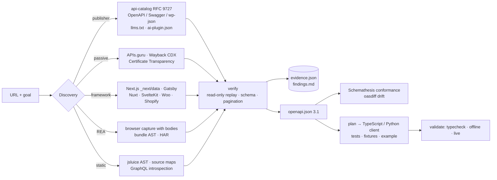

<div align="center">

**English** · [Português (Brasil)](docs/readme/README_pt-BR.md)

# rea-from-api: Reverse Engineer Any API

### One MCP for discovering, proving and integrating the data behind any website.

**See data on a site you need. Find out exactly how it is served — with evidence — and get a tested client.**

[](LICENSE)
[](https://www.npmjs.com/package/rea-from-api)
[](https://github.com/vitorcgo/rea-from-api/actions/workflows/ci.yml)
[](#quick-start)
[](#quick-start)
[](#mcp-tools)
[](docs/evidence-model.md)
[](https://github.com/morluto/rea)

[Quick start](#quick-start) · [How it works](#how-it-works) · [What you can discover](#what-you-can-discover) · [Showcases](#showcases) · [FAQ](#faq) · [Documentation](#documentation)

<code>npx rea-from-api setup</code>

</div>

> [!IMPORTANT]
> rea-from-api is an independent project built **on top of** [REA](https://github.com/morluto/rea)
> by morluto. It is not affiliated with REA. Get REA itself only from
> [morluto/rea](https://github.com/morluto/rea), [rea.tools](https://rea.tools/) or the
> [rea-agents npm package](https://www.npmjs.com/package/rea-agents) — rea-from-api installs that
> package as a pinned dependency.

---

Need the product list, prices, packages, listings or stats that a website shows? Ask your agent to
investigate it with rea-from-api. It finds where the data really comes from — an official API, a
publisher-declared OpenAPI document, the XHR calls a single-page app makes, a framework data route,
or JSON embedded in the HTML — verifies each source with read-only requests, writes the observed
API down as **OpenAPI 3.1**, and generates a **tested TypeScript or Python client** for your project.

Every claim carries evidence: which strategy found it, the request that confirmed it, the SHA-256 of
the bytes, and REA's own Evidence ids when REA's browser or bundle analysis observed it. Endpoints are
never invented: a route seen in JavaScript stays *inferred* until a real response proves it.

REA is the reverse-engineering engine for the browser side (Playwright capture with response bodies,
AST analysis of web bundles, HAR/mitmproxy/SAZ parsing). rea-from-api adds the API layer REA does not
have: discovery connections beyond the browser, replay and verification, schema and pagination
inference, OpenAPI export, conformance testing, drift monitoring and code generation.

## Quick start

Works on Windows, macOS and Linux with Node.js 22.18+ and npm.

### Set up your agent

```bash
npx rea-from-api setup
```

Setup detects your agents, shows exactly what it will change, and asks before applying. It registers
the `rea-from-api` MCP server (backing up each config) and installs the skill (`SKILL.md`). Restart your
agents afterward.

| Agent | `--agent` | Config |
|---|---|---|
| Claude Code | `claude-code` | `~/.claude.json` + `~/.claude/skills/rea-from-api` |
| Claude Desktop | `claude-desktop` | `claude_desktop_config.json` |
| Codex | `codex` | `~/.codex/config.toml` |
| Cursor | `cursor` | `~/.cursor/mcp.json` |
| VS Code (Copilot) | `vscode` | user `mcp.json` |
| Windsurf | `windsurf` | `~/.codeium/windsurf/mcp_config.json` |
| Gemini CLI | `gemini` | `~/.gemini/settings.json` |
| Current project | `project` | `.mcp.json` + `.claude/skills/rea-from-api` |

`--agent <id>` (repeatable) or `--all` choose agents non-interactively, `--yes` skips the prompt,
`--dry-run` only prints the plan and `--uninstall` removes everything setup added. Any other MCP client
can run the server with `npx -y rea-from-api mcp`.

Check what is available for deeper analysis:

```bash
npx rea-from-api doctor      # Node, REA, Chromium and the optional engines (jsluice, Schemathesis, oasdiff)
```

<details>
<summary><strong>From source</strong></summary>

```bash
git clone https://github.com/vitorcgo/rea-from-api && cd rea-from-api
npm install
node bin/rea-from-api.mjs setup --agent claude-code
```

A checkout runs the TypeScript sources directly; setup links the skill to it so updates apply at once.
</details>

### Ask your agent

```text
Investigate https://example.com, find out how it serves its public product data,
show me the evidence, and build a TypeScript integration for my project.
```

### Use the terminal

```bash
npx rea-from-api run https://example.com \
  --goal "public product data" --target ../my-project --live --fuzz
```

`run` = `investigate` → `plan` → `generate` → `validate` (+ Schemathesis with `--fuzz`).
Every step also exists on its own; see `rea-from-api help`.

### APIs that need your key

Most official APIs require an API key. Give rea-from-api **your own** key through an environment
variable; it is sent only to the target's API, verified like everything else, and never written to
reports, fixtures or generated code. The generated client reads it from the environment the same way.

```bash
export MY_API_KEY=...            # PowerShell: $env:MY_API_KEY = "..."
npx rea-from-api run https://api.example.com/docs --goal "orders data" \
  --auth-env MY_API_KEY --auth-header X-Api-Key        # or: --auth-query api_key
```

## How it works



Your agent calls the same operations through MCP that you can run from the terminal. Results are
compact summaries with paths to the full artifacts (`findings.md`, `endpoints.json`, `evidence.json`,
`openapi.json`, `plan.md`, `validation.md`).

## What you can discover

| Source | What rea-from-api returns | Requirements |
|---|---|---|
| Publisher-declared APIs | [RFC 9727](https://www.rfc-editor.org/rfc/rfc9727) `/.well-known/api-catalog`, `Link: rel=service-desc`, `ai-plugin.json`, `llms.txt` → specs and docs | none |
| OpenAPI / Swagger / WordPress REST | Documented operations (JSON or YAML), same-site API servers | none |
| Public API directories | [APIs.guru](https://apis.guru) official specs for the domain | network access to api.apis.guru |
| Web history | API/JSON URLs the Wayback Machine archived for the site, re-verified | network access to web.archive.org |
| API hosts | `api.*`, `developer.*` hosts from Certificate Transparency, probed for specs only | network access to crt.sh |
| Framework data routes | Next.js `/_next/data/<buildId>`, Gatsby `page-data`, Nuxt `_payload`, SvelteKit `__data`, WooCommerce Store API, Shopify storefront JSON, Drupal JSON:API | fingerprinted framework |
| Browser traffic | fetch/XHR requests with response bodies via REA `capture-browser-scenario` | REA + a Chromium-family browser |
| Web bundles | REA `analyze-web-bundle` AST candidates; [jsluice](https://github.com/BishopFox/jsluice) URLs with methods/headers/params; **source maps** → original modules | REA + Chromium; jsluice optional |
| GraphQL | Schema via the standard introspection query (one request, no brute forcing) | public introspection |
| Your own session | HAR / mitmproxy / Fiddler SAZ you recorded, parsed offline by REA with credentials redacted | REA |
| HTML | JSON-LD, `__NEXT_DATA__`, inline state, GET forms, technology fingerprints | none |

### What you get

| Output | Details |
|---|---|
| Evidence | Every endpoint: confirmed / observed / inferred / unavailable, test status, confidence, goal relevance, evidence ids, sha256 |
| OpenAPI 3.1 | `investigation/openapi.json` with `x-rea-from-api` provenance — feeds Spectral, Prism, any generator |
| Clients | TypeScript (zero runtime deps) or Python (stdlib only): types, validators, pagination, cache, retries, timeouts, redacted logs |
| Tests | Recorded-fixture tests, retry/cache/pagination tests, opt-in live tests, runnable example |
| Conformance | [Schemathesis](https://schemathesis.io) property-based tests on confirmed GET operations (positive inputs, rate limited) |
| Drift | `diff` / `monitor`: structural changes + [oasdiff](https://github.com/oasdiff/oasdiff) breaking-change classification |

Optional engines are detected, never installed for you (REA's model): `jsluice`, `schemathesis`,
`oasdiff`, `mypy`. `doctor` shows what is available and the install command for the rest.

## Showcases

### PyPI: from a project page to a validated client

[`examples/pypi/`](examples/pypi) is the unedited output of one `run` against
`https://pypi.org/project/requests/`. REA's browser capture observed 7 data requests (PyPI HTML
fragments and third-party `api.github.com` calls, which were *not* replayed); jsluice and REA found
account-management routes in the JavaScript, which the verifier refused to call. PyPI's documented
JSON API is not visible on the page and its `robots.txt` disallows it for crawlers, so it was passed as
`--seed` with an explicit `--robots-exempt`, verified once, and turned into a client that passed
typecheck, offline tests, live tests and the example ([validation.md](examples/pypi/validation.md)).

### A single-page shop: every connection at once

The test fixture ([`tests/fixtures/site.ts`](tests/fixtures/site.ts)) is a client-rendered shop that
hides its data behind fetch calls. One investigation finds the products API in REA's traffic capture,
an RFC 9727 catalog pointing to a YAML spec, an APIs.guru listing, a dead Wayback URL (verified as gone),
a reviews endpoint that exists **only in the original TypeScript recovered from the source map** (its
`?product=` value filled from a real product id), the GraphQL schema, and a Next.js data route on another
page — then generates TypeScript and Python clients that pass their own tests. `npm test` runs all of it.

### Schemathesis finds what the samples hid

On the same fixture, conformance testing reported `ST108 Response violates schema`: `page`, `total_pages`
and `next` can be `null` — never seen in the recorded pages. That is the point of exporting OpenAPI: the
contract you reverse engineered gets tested beyond the examples you happened to observe.

## Safety

Only `GET`/`HEAD` are sent automatically (plus the one standard GraphQL introspection query). robots.txt is
honoured; account, admin, auth, checkout and delete-like routes are never replayed; login redirects and
401/403 mark endpoints as requiring the user's **own** credentials; bot challenges and CAPTCHAs stop the
run — there is no bypass. Request, time and retry budgets have hard ceilings. Cookies, tokens and header
values never reach reports, fixtures or generated code. Site content is treated as data, never as
instructions. Details: [docs/safety.md](docs/safety.md).

## MCP tools

`investigate` · `list_endpoints` · `get_endpoint` · `read_findings` · `export_openapi` ·
`plan_integration` · `generate_integration` · `validate_integration` · `run_conformance` ·
`diff_specs` · `monitor` · `doctor`

## FAQ

<details>
<summary><strong>Does it only work with Playwright / a browser?</strong></summary>

No. The browser (through REA) is one of eleven strategies. Publisher declarations, OpenAPI probes,
framework conventions, APIs.guru, the Wayback Machine, Certificate Transparency, jsluice, source maps
and GraphQL introspection all work without a browser (`--browser off`).
</details>

<details>
<summary><strong>Will it find undocumented endpoints?</strong></summary>

It finds endpoints the site itself uses (traffic, bundles, source maps, history) and verifies the
read-only ones. They are labelled undocumented: they can change without notice, and their reuse may be
restricted by the site's terms. Check them before depending on the data.
</details>

<details>
<summary><strong>What if the API needs a key or a login?</strong></summary>

Endpoints that answer 401/403 or redirect to a login page are marked `auth: required`. Use your own
key with `--auth-env` (see [APIs that need your key](#apis-that-need-your-key)), or record a HAR of
**your own** session and pass `--har`. Nothing is extracted from the site, and no authentication is
bypassed.
</details>

<details>
<summary><strong>Which agents can use it?</strong></summary>

Any agent that supports local MCP servers. `setup` configures Claude Code, Claude Desktop, Codex,
Cursor, VS Code, Windsurf, Gemini CLI or a project `.mcp.json`; any other client can run
`npx -y rea-from-api mcp`. The skill is plain `SKILL.md`.
</details>

<details>
<summary><strong>Does it send my target anywhere?</strong></summary>

Passive sources send only the domain name to APIs.guru, the Wayback Machine and crt.sh; disable them with
`--passive off`. Everything else runs locally. Your agent's model provider has its own data policy.
</details>

## Documentation

- [Research behind the design](docs/research.md) — connections, OpenAPI as the central artifact, rejected techniques
- [Workflow and strategies](docs/workflow.md) — order, limits, exit codes
- [Evidence model](docs/evidence-model.md) — endpoint and evidence fields, OpenAPI extensions
- [How REA is used](docs/rea-integration.md) and the [REA audit](docs/rea-audit.md)
- [Safety and boundaries](docs/safety.md)
- [Extending](docs/extending.md) — new strategies and generators
- [`SKILL.md`](SKILL.md) — agent instructions

## Development

```bash
npm run typecheck
npm test        # unit tests + full pipeline, MCP, setup and generator tests against a local fixture site
npm run build   # compiles dist/ (what the npm package runs)
```

CI runs the suite on Windows, macOS and Linux with Node 22 and 24, and installs the packed tarball into
a clean directory to prove the published package works.

## License

MIT — see [LICENSE](LICENSE). REA is MIT © 2026 morluto and is used as an unmodified npm dependency;
see [THIRD_PARTY_NOTICES.md](THIRD_PARTY_NOTICES.md).
