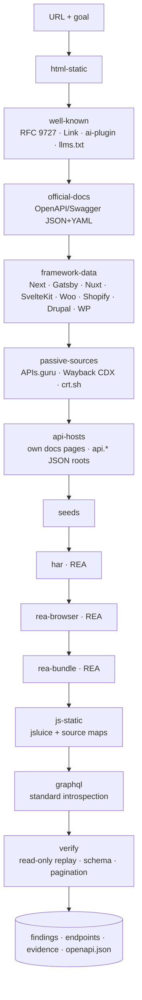

# Workflow and strategies

| Strategy | Network | Produces | Status it can assign |
|---|---|---|---|
| `html-static` | 1 GET of the target | page, tech hints, embedded blocks, GET forms | confirmed (page), inferred (forms) |
| `well-known` | ≤ 3 GETs on target + spec fetches | publisher-declared specs/docs | observed + documented |
| `official-docs` | ≤ `maxSpecProbes` GETs, same origin | OpenAPI/Swagger/wp-json operations | observed + documented |
| `framework-data` | wp-json index only | data routes of the fingerprinted framework | inferred (documented for Woo/Drupal) |
| `passive-sources` | APIs.guru, web.archive.org, crt.sh (+ spec probes on same-site API hosts) | official specs, historical URLs, API hosts | observed / inferred |
| `api-hosts` | 1 GET per same-site API root, ≤ 6 docs pages per docs host, ≤ 4 hosts | `GET /path` routes and example URLs from the site's docs; routes listed by JSON API roots | inferred + documented |
| `seeds` | none | caller-provided candidates | inferred |
| `har` | none (offline, REA) | requests from the user's HAR | observed / unavailable |
| `rea-browser` | browser traffic (not counted) | fetch/XHR with bodies | observed / unavailable |
| `rea-bundle` | one page load | REA AST candidates | inferred |
| `js-static` | ≤ `maxScripts` + ≤ 5 source maps, same origin | URLs, methods, headers, params; original modules | inferred |
| `graphql` | 1 POST (introspection) per endpoint, ≤ 2 | schema, query list | confirmed / observed / unavailable |
| `verify` | remaining budget | replay, schema, pagination, rate limits; fills `{params}` from observed data | confirmed / unavailable |

`verify` order: goal relevance first, then evidence strength; templated URLs last so
their path and query placeholders can be filled with real values from list responses confirmed
earlier (e.g. `items[0].id` → `/products/{id}` or `?product=`). Documented routes can also take
their values from the page URL, by name (`/project/requests` → `{project}`) or, when the counts match
exactly, by position (`/nodejs/node` → `{owner}/{repo}`); those are verified early. It never guesses values.

If the target answers with a bot challenge, it is not contacted again; `passive-sources`, `api-hosts`,
`seeds` and `har` still run because they use other hosts or local files.

## Choosing the access strategy

1. Official API (spec/seed, documented) → preferred.
2. Undocumented JSON seen in traffic → usable, flagged as unstable; check terms.
3. Embedded JSON in HTML (JSON-LD, `__NEXT_DATA__`, inline state) → `embedded-json`
   integration with HTML fetch + extraction.
4. Rendered-only content with no JSON anywhere → not generated automatically;
   the findings say so. A CSS-selector extractor must be hand-written.
5. Native/desktop apps → use REA's own skill/MCP tools directly (outside this pipeline).

## Limits (defaults; `src/core/limits.ts`)

| Limit | Default | Ceiling |
|---|---|---|
| direct requests | 60 | 500 |
| wall clock | 5 min | 30 min |
| per-request timeout | 15 s | none |
| retries (network, 502/503/504, 429 with Retry-After ≤ 10 s) | 2 | 4 |
| per-host pacing | 300 ms | none |
| body read | 2 MiB | none |
| scripts scanned | 15 | 60 |
| spec probes | 10 | none |
| pagination pages checked | 2 | 10 |
| REA call timeout | 120 s | none |

A 429 without an acceptable Retry-After, or any bot challenge, stops all further
requests to that host for the run.

## After the investigation

- `export-openapi` / `openapi.json` → Spectral, Prism, any OpenAPI generator.
- `conformance` → Schemathesis on confirmed GET operations (positive inputs, `--rate-limit 2/s`, `--max-time 120`).
- `monitor` → re-runs with the same inputs and writes `monitor/<time>/drift.md`; `diff A B` compares any two specs (oasdiff when installed).
- `plan --language typescript|python` → `generate` → `validate`.

## Exit codes

`0` ok · `1` error · `2` nothing usable / validation or conformance failed / breaking drift ·
`3` refused to overwrite files.
