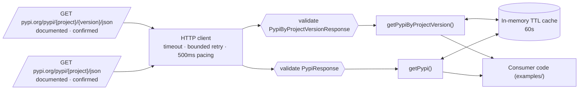

# Integration plan — pypi-json

Goal: Discover how PyPI exposes public package metadata (versions, releases) and build a TypeScript integration

Strategy: **json-api** · language: typescript

## Sources

- `getPypiByProjectVersion` ← `GET https://pypi.org/pypi/{project}/{version}/json` (documented, confirmed, auth none)
- `getPypi` ← `GET https://pypi.org/pypi/{project}/json` (documented, confirmed, auth none)

## Execution order

1. getPypiByProjectVersion
2. getPypi

## Transformations

- none

## Errors, retries, cache, rate limit

- HttpError (non-2xx) with status, retryable flag and redacted URL
- ValidationError when a response no longer matches the observed schema (format drift)
- TimeoutError per request (AbortSignal)
- bounded retries with exponential backoff for network errors, 429 (honouring Retry-After up to a cap) and 502/503/504
- cache: memory-ttl, default TTL 60000 ms
- pacing: 500 ms between requests (no rate-limit headers observed; conservative default of 2 req/s)

## Authentication

- Selected endpoints answered without credentials during verification.

## Target

- kind: none; output: `integration`
- No target project given: a standalone package is generated.

## Risks

- Respect the site's terms of use, robots.txt and rate limits; confirm that reuse/redistribution of the data is permitted.

## Excluded endpoints

- get-171be125: not confirmed (observed, test skipped-cross-origin)
- get-b0a2c059: response format binary
- get-0ff29434: response format html
- get-aa82a775: response format html
- get-bc3e279f: not confirmed (unavailable, test skipped-robots)
- get-43f441ec: not confirmed (inferred, test skipped-sensitive-path)
- get-2703a397: not confirmed (inferred, test skipped-sensitive-path)
- post-9c20df45: write operation — never generated automatically
- get-27e07e87: not confirmed (inferred, test skipped-sensitive-path)
- get-04720b64: not confirmed (inferred, test skipped-sensitive-path)
- get-c182d6ea: not confirmed (inferred, test skipped-sensitive-path)
- post-ffcb4ba9: write operation — never generated automatically
- get-88845aca: not confirmed (unavailable, test skipped-robots)
- get-7ec9e483: not confirmed (observed, test skipped-cross-origin)
- get-02a0d3ec: not confirmed (unavailable, test skipped-cross-origin)
- get-7573cdc5: not confirmed (inferred, test skipped-cross-origin)

## Diagram

