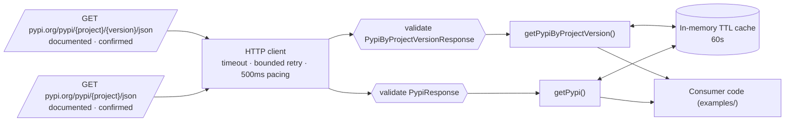

# pypi-json

Generated by [rea-from-api](https://github.com/vitorcgo/rea-from-api) for: _public package metadata_

Source: https://pypi.org/project/requests/ · strategy: **json-api**

## Functions

- `getPypiByProjectVersion(path, query?, opts?)` → `PypiByProjectVersionResponse`: `GET https://pypi.org/pypi/{project}/{version}/json` (documented, confirmed)
- `getPypi(path, query?, opts?)` → `PypiResponse`: `GET https://pypi.org/pypi/{project}/json` (documented, confirmed)


## Install & run

```bash
npm install   # dev dependencies only (typescript, @types/node)
npm test      # offline tests against recorded fixtures
LIVE=1 npm run test:live   # opt-in live smoke tests
node examples/basic.ts
```

Configuration: see `.env.example`. No credentials needed for the selected endpoints at generation time.

## Behaviour

- Timeouts per request, bounded retries (network errors, 429 with Retry-After cap, 502/503/504).
- 500 ms minimum interval between requests (no rate-limit headers observed; conservative default of 2 req/s).
- In-memory TTL cache (60000 ms default); `opts.fresh` bypasses it.
- Responses are validated against the shape observed during investigation; `ValidationError` means the source changed.
- Logs (opt-in `logger`) redact sensitive query values and never include headers.

## Architecture



## Limitations & risks

- Respect the site's terms of use, robots.txt and rate limits; confirm that reuse/redistribution of the data is permitted.
- Types/validators describe observed responses, not a documented contract.
